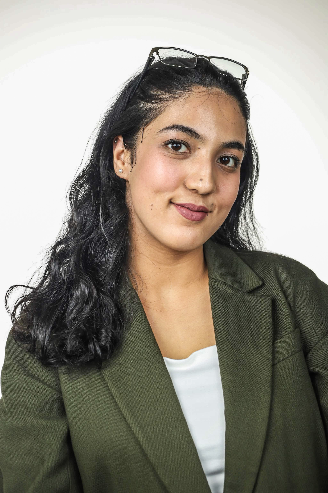

{width=220px}

Hi, I’m Pratistha Regmi! I’m a Business Analytics master’s student at Baruch College, and I enjoy finding the story behind the numbers. My background in business and event operations taught me to ask practical questions; now I’m learning how to answer them with data. This site is where I’ll share my STA 9750 projects, what I discover along the way, and a little of my personality too.

## Main Character Energy 

```{r}
#| echo: false
#| results: asis

vibes <- c(
  "📚 **The Plot Detective:** You will overanalyze one fictional character today—and be right.",
  "📊 **The Data Heroine:** One confusing problem is about to make sense.",
  "🎬 **The Dramatic Lead:** Today's minor inconvenience deserves a full movie soundtrack.",
  "☕ **The Comeback Era:** Take a breath. Your next chapter is looking good."
)

cat(sample(vibes, 1))
```
## A little data story 🚲

In my CitiBike analysis, customers took longer rides on average than subscribers. Here’s that comparison in R:

```{r}
#| echo: false

ride_minutes <- c("Customers" = 22, "Subscribers" = 13)

barplot(
  ride_minutes,
  col = c("#69B3A2", "#465775"),
  ylim = c(0, 25),
  ylab = "Average ride length (minutes)",
  main = "Who stays on a CitiBike longer?"
)
```

## My Mini-Projects

This is where my STA 9750 projects will live. The pages are placeholders for now, and I’ll update them as I complete each project.

- [Mini-Project 1 →](mp01.html)
- [Mini-Project 2 →](mp02.html)
- [Mini-Project 3 →](mp03.html)
- [Mini-Project 4 →](mp04.html)